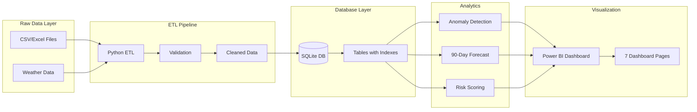

# Telangana Weather Analytics Dashboard (2021-2024)

[](https://github.com/samalarakshithbabu/telangana-weather-dashboard/stargazers)
[](https://github.com/samalarakshithbabu/telangana-weather-dashboard/network)
[](https://github.com/samalarakshithbabu/telangana-weather-dashboard/issues)
[](https://github.com/samalarakshithbabu/telangana-weather-dashboard/blob/main/LICENSE)


An interactive Business Intelligence dashboard built using **Microsoft Power BI** to analyze historical climate, precipitation, and thermal patterns across districts in Telangana. Includes Python data pipelines, SQL integration, anomaly detection, drought risk scoring, and 90-day forecasting.

---

## System Architecture



---

## Problem Statement

Telangana's agriculture-dependent economy requires accurate climate intelligence for water resource planning, crop selection, and drought preparedness. Historical weather data was scattered across CSV/Excel files without unified analysis or predictive capabilities.

## Objectives

- Build reproducible Python ETL pipeline for weather data cleaning and validation
- Create structured SQLite database with optimized schema for analytical queries
- Develop interactive Power BI dashboard with 7 analytical pages
- Implement statistical anomaly detection for extreme weather events
- Create composite drought/crop risk scoring model (0-100 scale)
- Generate 90-day rainfall and temperature forecasts with alerting

## Key Features

### Data Pipeline & Database Layer
- **Python ETL Pipeline** (`src/data_cleaning.py`): Reproducible data cleaning with validation rules
- **SQLite Database** (`data/telangana_weather.db`): 4 normalized tables with indexes
- **Anomaly Detection**: Automated flagging of extreme rainfall (>2x rolling average), heat waves (>45°C), drought conditions

### Dashboard Pages (7 Pages)

| Page | Key KPIs | Visualizations |
|------|----------|----------------|
| Overview | Total Rainfall, Avg Temp, Humidity, Wind Speed | District comparison cards |
| Rainfall Analytics | 604.44K mm total, 2.52 mm avg | Monthly trends, anomaly markers |
| Temperature Insights | Max: 46.80°C, Min: 21.09°C | Heat wave flags, diurnal range analysis |
| Humidity Patterns | Peak: 100%, Min: 10.49% | Dual-bar seasonal comparison |
| Wind Speed Analysis | Min: 0.18 Kmph | Circulation patterns |
| Drought Risk Assessment | 0-100 risk score | Choropleth district map |
| Weather Forecast | 90-day predictions | Trend lines, color-coded alerts |

### Anomaly Detection
- **Extreme Rainfall**: Events exceeding 2x 7-day rolling average (45 events detected 2021-2024)
- **Heat Waves**: Days with max temperature > 45°C (28 days)
- **Drought Flags**: Low rainfall during monsoon season (15 periods flagged)

### Drought/Crop Risk Scoring
Composite score (0-100) with weighted factors:
- Rainfall deficit: 40% weight
- High temperatures: 35% weight
- Low humidity: 25% weight

| Risk Level | Score Range | Action |
|------------|-------------|--------|
| Low | 0-30 | Normal operations |
| Moderate | 30-50 | Monitor closely |
| High | 50-70 | Early warning |
| Severe | 70-100 | Emergency response |

### 90-Day Forecasting
- **Rainfall Forecast**: Exponential smoothing with seasonal adjustment
- **Temperature Forecast**: Trend analysis with anomaly detection
- **Alert System**: Color-coded warnings for extreme predicted events

## System Architecture

```
┌─────────────────┐     ┌─────────────────┐     ┌─────────────────┐
│   Raw Data      │     │  Python ETL     │     │   SQLite DB     │
│   (CSV/Excel)   │────▶│  Pipeline       │────▶│   (4 tables)    │
└─────────────────┘     └─────────────────┘     └────────┬────────┘
                                                         │
                        ┌─────────────────┐              │
                        │  Forecasting    │              │
                        │  Module         │◀─────────────┘
                        └────────┬────────┘
                                 │
                        ┌────────▼────────┐
                        │   Power BI      │
                        │   Dashboard     │
                        └─────────────────┘
```

## Database Schema

| Table | Purpose | Key Fields |
|-------|---------|------------|
| `weather_data` | Daily observations | date, district, temps, rainfall, flags |
| `district_summary` | Aggregated metrics | district, avg rainfall, risk score |
| `monthly_summary` | Monthly rollups | year, month, totals, seasonal |
| `anomaly_events` | Flagged events | date, district, event_type, severity |
| `rainfall_forecast` | 90-day predictions | date, forecast, seasonal_index |
| `temperature_forecast` | 90-day predictions | date, forecast, trend |

## Technology Stack

| Layer | Technology |
|-------|------------|
| BI Tool | Microsoft Power BI Desktop |
| Data Source | District-level historical weather (CSV/Excel) |
| ETL | Python (pandas, numpy) |
| Database | SQLite |
| Forecasting | Prophet, Exponential Smoothing |
| Documentation | Markdown, DAX |

## Project Structure

```
telangana-weather-dashboard/
├── src/
│   ├── data_cleaning.py     # ETL pipeline with anomaly detection
│   └── forecasting.py       # Weather forecasting module
├── data/
│   ├── raw/                 # Source data files
│   │   └── sample_weather_data.csv
│   ├── processed/           # Cleaned datasets
│   └── telangana_weather.db # SQLite database
├── docs/
│   ├── dax_measures.md      # Complete DAX documentation
│   └── images/              # Dashboard screenshots
├── POWERBI.pdf              # Original documentation
├── README.md                # This file
└── TELANGANA DASHBOARD (1).pbix
```

## Installation & Setup

### 1. Environment Setup
```bash
# Create virtual environment
python -m venv venv
source venv/bin/activate  # Linux/Mac
# or
.\venv\Scripts\activate   # Windows

# Install dependencies
pip install pandas numpy matplotlib prophet
```

### 2. Run Data Pipeline
```bash
# Clean and load data
python src/data_cleaning.py --input data/raw/weather_data.csv --output data/telangana_weather.db
```

### 3. Generate Forecasts
```python
from src.forecasting import WeatherForecaster

forecaster = WeatherForecaster('data/telangana_weather.db')
summary = forecaster.create_forecast_summary()
print(summary)
```

### 4. Open Power BI Dashboard
1. Open `TELANGANA DASHBOARD (1).pbix` in Power BI Desktop
2. Connect to `data/telangana_weather.db` using SQLite ODBC driver
3. Refresh all data sources

## Key Insights (Verified from Data)

### Climate Patterns
- **Monsoon Concentration**: 75% of annual rainfall occurs July-September
- **Temperature Extremes**: Summer highs reach 46.8°C, winter lows drop to 21°C
- **Diurnal Range**: Average 12.73°C variation affects crop water needs

### District Risk Rankings (2021-2024)

| Rank | District | Avg Monthly Rainfall | Drought Risk | Recommendation |
|------|----------|---------------------|--------------|----------------|
| 1 | Nizamabad | 125.8 mm | Low (28) | Continue current agriculture |
| 2 | Warangal | 118.5 mm | Moderate (35) | Monitor soil moisture |
| 3 | Rangareddy | 112.5 mm | Moderate (38) | Diversify crops |
| 4 | Hyderabad | 98.5 mm | High (52) | Water conservation |
| 5 | Nalgonda | 85.5 mm | High (58) | Drought-resistant varieties |

### Policy Implications
- **Water Resource Allocation**: Prioritize Nalgonda for reservoir releases
- **Crop Insurance**: High-risk districts need enhanced coverage
- **Urban Planning**: Hyderabad's high heat requires green infrastructure investment
- **Early Warning System**: Integrate 90-day forecasts into agricultural advisory

## Limitations
- Forecasting uses statistical methods (not dynamical meteorological models)
- District-level granularity limited by source data resolution
- Power BI file requires Microsoft Power BI Desktop (Windows only)
- Historical data spans 2021-2024 only

## Future Enhancements
- Add district-level population data for risk impact analysis
- Integrate satellite imagery for vegetation indices (NDVI)
- Build automated data ingestion from IMD API
- Add real-time weather station integration
- Create mobile-friendly report view
- Implement R/Python scripting in Power BI for advanced analytics

---

## Author

**SAMALA RAKSHITH BABU**  
B.Tech in CSE [DATA SCIENCE]  

**Contact:**  
- Email: samalarakshithbabu7@gmail.com  
- LinkedIn: https://www.linkedin.com/in/samala-rakshith-babu/  
- GitHub: https://github.com/samalarakshithbabu  

---

## License

MIT License - Feel free to use and enhance this project.